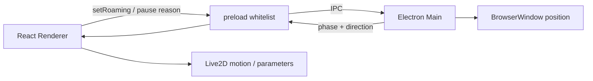

# Neuro 桌面漫游与 Live2D 动作设计

更新日期：2026-06-21（参数动画 walk cycle、多显示器 clamp、窗口位置持久化已实现）

## 1. 目标

让桌宠不只是固定在右下角说话，而是能：

- 在当前桌面工作区内自然走动。
- 走动方向、Live2D 姿势和窗口位移同步。
- 偶尔停下、观察、伸懒腰、说话和回应点击。
- 不越过任务栏，不丢到屏幕外，不妨碍输入和拖动。
- 用户可以随时关闭漫游。

第一版只做“当前显示器底部横向漫游”，这已经能产生明显桌宠感。桌面图标碰撞、识别其他窗口、跳到任务栏等复杂行为以后再做。

## 2. 当前实现审计

### 2.1 Electron 窗口

`frontend/electron-main.cjs` 当前创建：

```text
300x420 BrowserWindow
transparent: true
frame: false
alwaysOnTop: true
contextIsolation: true
sandbox: true
nodeIntegration: false
```

窗口出生在主显示器右下角，可拖动，可通过托盘切换点击穿透。

缺少：

- `getBounds/setPosition/setBounds` 漫游循环。
- 当前显示器选择和多显示器处理。
- 漫游开关、暂停条件和位置持久化。
- main process 到 renderer 的移动状态事件。

### 2.2 Live2D 动作

`useIdleAnimations.js` 已实现参数级动画：

- 眨眼。
- 呼吸。
- 随机环顾。
- 偶尔伸懒腰/歪头。

`Live2DModel.jsx` 已实现窗口内伪走动：改变模型 `x` 和 `ParamBodyAngleX`，但没有调用入口。即使启用，也只会在 300px canvas 内左右晃动。

### 2.3 PinkFox 素材限制

当前 `PinkFox.model3.json` 的 `FileReferences` 只有 Moc、Texture、Physics 和 DisplayInfo，没有 `Motions` 或 `Expressions` 注册。

目录中存在：

- 多个 `*.exp3.json`，当前代码直接修改参数使用表情。
- `kuku.motion3.json`，但没有在 `model3.json` 注册。

因此：

- `autoAddRandomMotion=true` 没有足够 Motion 可随机播放。
- `model.motion('TapBody')` 大概率找不到对应 Motion group。
- “动作少”首先是素材清单和注册问题，不是 React 动画次数不够。

## 3. 正确的职责分工



### Main process 负责

- 屏幕和工作区坐标。
- BrowserWindow 位置。
- 目标点、速度、边界和多显示器。
- 漫游开关和位置持久化。

### Renderer 负责

- 播放 idle/walk/turn/talk/think 动作。
- 朝向、身体倾斜、呼吸和表情。
- 告诉 main process 当前是否应暂停漫游。

### Preload 负责

只暴露白名单 API，例如：

```js
window.petAPI.setRoaming(enabled)
window.petAPI.setRoamingPaused(reason, paused)
window.petAPI.onMovementState(callback) // 返回 unsubscribe
```

不要把完整 `ipcRenderer` 暴露给网页。

## 4. 动作资产清单

先建立运行时动作清单，不能凭文件名猜。

### 4.0 已实现（2026-06-21）：参数动画驱动的完整动作系统

PinkFox 没有可用的 walk motion（Kuku 实为眼泪动画），因此第一版全套动作都用参数动画合成，
不依赖新增 motion3 文件。各状态对应 hook：

| 状态 | 实现 | 参数 |
|---|---|---|
| idle | `useIdleAnimations` | 眨眼(ParamEyeLOpen/R)、呼吸(ParamBreath)、环顾(HeadAngleX/Y)、伸懒腰(ParamBodyAngleZ) |
| idle 微动作 | `useIdleAnimations` + `idleActions.js` | 8~20s 随机触发：歪头/看远方/轻摆/眯眼/抬头/侧倾（6 种，不连续重复） |
| walk | `useWalkCycle` + `walkCycle.js` | PositionY 起伏、HipAngleX 重心、ParamBodyAngleZ/ParamAngleZ 摆动、ParamBodyFeetL/R 迈步 |
| talk 口型 | `useLipSync` + `lipSync.js` | AnalyserNode 采集 TTS 音量 → RMS → ParamMouthOpenY/JawOpen/ParamMouthForm |
| talk 手势 | `useSpeakingGesture` | 说话时 Param34/36/38/40(手)+ShoulderZ(肩)周期性轻微摆动 |
| think | `useThinkPose` | HeadAngleY(抬头)+ParamBrowLY/RY(聚眉)+EyeSquint(眯眼) |
| react(点击) | `clickReactions.js` + Live2DModel hit | 6 种加权反应：惊讶/吐舌/眯眼笑/轻跳/歪头/哭(稀有)，钟形过渡 |
| emotion | `Live2DModel.showExpression` | key2~key17 表情参数（happy→咪咪眼 等） |

口型同步需要 WebAudio：`useAudioQueue` 改用 AudioContext + MediaElementSource + AnalyserNode，
AudioContext 不可用时降级为无口型普通播放。

### 第一批必要动作

| 状态 | Motion/参数 | 用途 |
|---|---|---|
| idle | 呼吸、眨眼、轻摆 | 默认状态 |
| walk | 循环走路 | 窗口移动时播放 |
| turn | 身体转向或快速倾斜 | 改变方向时 |
| talk | 口型 + 轻摆 | TTS 播放时 |
| think | 头部上看/疑惑表情 | LLM 请求时 |
| react | 点击回应/开心/生气 | 交互反馈 |

### 第二批动作

```text
stretch
sit
sleep
wake
peek
wave
celebrate
```

不要一次做几十个。先让 idle、walk、talk、think 四种状态稳定切换。

## 5. Motion 注册

PinkFox 至少需要在 `model3.json` 注册已有动作：

```json
{
  "FileReferences": {
    "Moc": "PinkFox.moc3",
    "Textures": ["PinkFox.8192/texture_00.png"],
    "Physics": "PinkFox.physics3.json",
    "DisplayInfo": "PinkFox.cdi3.json",
    "Motions": {
      "Idle": [
        {
          "File": "kuku.motion3.json",
          "FadeInTime": 0.5,
          "FadeOutTime": 0.5
        }
      ]
    }
  }
}
```

如果 `kuku` 不是可循环待机，不要强行当 walk。真正好看的走路需要在 Cubism Editor 制作 walk cycle，至少包含：

- 身体上下起伏。
- 重心左右交替。
- 手臂/衣物反向摆动。
- 迈步节奏或腿部替代动作。
- 左右朝向处理。

PinkFox 参数动画中使用了 `HeadAngleX/HeadAngleY` 等 ID，但这些参数可能不存在，异常被静默忽略。实施动作前先增加一个开发期参数诊断器，枚举 core model 的实际参数 ID，确认后再建立映射。

### 5.1 已实现（2026-06-21）：参数动画 walk cycle

诊断确认 PinkFox 有 198 个参数，身体类参数齐全（`PositionY`、`HipAngleX`、`ParamBodyAngleZ`、
`ParamAngleZ`、`ParamBodyFeetL/R` 等），而 Kuku 实际只驱动 `Param3/Param4`（左/右眼泪），
当 walk/idle 用是错的。因此第一版 walk 不新做 motion3 文件，改用参数动画合成：

- `frontend/src/walkCycle.js`：纯函数，把「步态相位」映射成参数值。左右脚半周期错开（`max(0,sin)`），
  抬脚顶点身体最高（钟形 `|sin|`），重心 `HipAngleX` 跟随抬脚同步左右交替，朝向镜像。
- `frontend/src/hooks/useWalkCycle.js`：RAF 驱动，步频随 `movementState.speed` 变化。
- `Live2DModel.jsx` 的 `setMovementState` 只负责朝向翻转（`scale.x`），身体步态交给 walk cycle，
  与 `useIdleAnimations` 互斥（walking 时 idle 关闭呼吸/环顾，避免参数打架）。
- 测试 `walkCycle.test.js`：脚反相、起伏峰值、朝向镜像、幅度上限。

多显示器与位置持久化也已落地：

- `roaming.cjs` 新增纯函数 `displayIdFor`（按窗口中心/重叠面积定位显示器）和
  `resolveStartupBounds`（saved.displayId 不存在时退回主屏右下）。`roamingTick` 每个 tick 用
  `screen.getDisplayMatching` clamp，并跟踪 `currentDisplayId`，显示器变化时清旧目标重选——
  这是拔副屏后的自然恢复机制。
- `windowState.cjs`：把 `{x,y,width,height,roamingEnabled,displayId}` 原子写到 Electron userData
  的 `window-state.json`。启动经 `resolveStartupBounds` clamp 后应用；拖动恢复 15s 后、托盘切换漫游、
  `before-quit` 各持久化一次。renderer 不参与位置读写。

## 6. 桌面漫游状态机

最小状态：

```text
DISABLED
IDLE
TURNING
WALKING
PAUSED
```

转换：

```text
DISABLED --开启--> IDLE
IDLE --计时结束--> TURNING/WALKING
WALKING --到达目标--> IDLE
任意状态 --用户交互/说话/思考--> PAUSED
PAUSED --原因全部解除--> IDLE
任意状态 --关闭--> DISABLED
```

暂停原因使用集合，不使用单个布尔值：

```text
panel-open
user-dragging
typing
thinking
speaking
dnd
fullscreen-app
```

只有集合为空时才能继续走，避免一个状态解除时错误覆盖另一个暂停原因。

## 7. 第一版移动算法

### 7.1 范围

使用当前窗口所在显示器：

```js
const display = screen.getDisplayMatching(win.getBounds())
const area = display.workArea
```

不要一直使用 `getPrimaryDisplay()`，用户把桌宠拖到副屏后应留在副屏。

### 7.2 地面线

第一版固定沿工作区底部移动：

```text
y = workArea.y + workArea.height - window.height
x ∈ [workArea.x, workArea.x + workArea.width - window.width]
```

任务栏已从 `workArea` 排除。

### 7.3 目标选择

- 当前点左右各保留 80px 最小移动距离。
- 70% 选择中距离目标，30% 选择远距离目标。
- 到达后停 2-8 秒。
- 连续两次不要选择几乎同一位置。
- 第一版不跨显示器。

### 7.4 速度

使用 delta time：

```text
walk_speed = 80-140 px/s
tick = 30 FPS
step = direction * speed * delta_seconds
```

BrowserWindow 坐标取整数。不要用 React `requestAnimationFrame` 移动窗口；窗口由 Electron main process 的 30 FPS 定时器驱动即可。

接近目标时使用缓出，但不要每帧按剩余距离乘固定比例，否则会产生永远到不了目标的尾巴。

## 8. 动作同步

Main process 每次状态变化发送：

```json
{
  "phase": "walking",
  "direction": "left",
  "speed": 110
}
```

Renderer 映射：

```text
walking + left  -> flip/ParamAngleY + walk motion
walking + right -> 正向 + walk motion
idle            -> idle motion + 参数呼吸
paused/speaking -> 停止 walk，播放 talk
thinking        -> think 表情/动作
```

窗口移动和动作状态必须来自同一状态机，不能 Renderer 自己随机走、main process 又随机移动。

## 9. 用户交互规则

- 漫游默认**关闭**（首次启动），用户通过托盘「桌面漫游」开启；用户选择会被持久化，下次保持上次状态。
- 展开控制坞、输入框聚焦、录音、说话、思考时暂停。
- 用户手动拖动后暂停 10-30 秒，再从新位置继续。
- 点击穿透开启时仍可漫游，但必须能从托盘关闭。
- 关闭漫游立即停止定时器，不继续缓慢漂移。
- 退出时保存最后合法位置和漫游开关。
- 启动时把旧位置 clamp 到当前可用显示器，防止拔掉副屏后窗口消失。

## 10. 与记忆联动

动作可以使用记忆结果，但不能执行模型返回的任意命令。

安全做法：后端只发送受限高层事件：

```text
remembered_happy_event
long_absence
user_completed_task
user_is_busy
```

前端将事件映射到本地白名单动作，例如挥手、开心、安静坐下。LLM 不能直接传文件名、Motion group 或 IPC channel。

## 11. 现有测试需要怎样改

当前 `desktopSurface.test.js` 禁止 `setWander` 和“走动”，目的是防止假按钮玩法。实现真实漫游时应将其替换为：

- MainPage 不出现虚假喂食/金币系统。
- preload 只暴露 `setRoaming/setRoamingPaused/onMovementState`。
- Electron main 使用 `screen.getDisplayMatching` 和 `workArea`。
- 移动位置被 clamp。
- sandbox、contextIsolation 和 nodeIntegration 安全设置保持。
- 关闭漫游会清理定时器。
- movement listener 有 unsubscribe，组件卸载不泄漏。

可将目标选择和 clamp 提取为纯函数，用 Node 内置测试直接验证，不需要启动 Electron。

## 12. 性能与稳定性

- 窗口移动 30 FPS 足够，不必 60 FPS。
- Live2D 参数动画仍用 Renderer RAF。
- 失焦或隐藏时停止漫游和不必要 RAF。
- `display-metrics-changed` 时重新 clamp。
- `win.isDestroyed()`、`win.isVisible()` 为每个 tick 的守卫。
- 单实例应用，避免两个桌宠互相覆盖。
- 不在移动循环里访问网络或 LLM。

## 13. 推荐实施顺序

1. ✅ 写 Motion/参数诊断输出，只记录 ID，不记录用户数据。（`Live2DModel.jsx` 已打印 parameterIds/motions）
2. ✅ 在 PinkFox model3 注册现有 `kuku`，验证能播放。（已注册，但 kuku 实为眼泪动画，见 5.1）
3. ✅ 建立 `idle/talk/think/react` 映射。（idle 走参数动画；walk 走 walkCycle；talk/think 由 emotion 参数映射）
4. ✅ main process 实现当前显示器底部横向移动纯函数和测试。（`roaming.cjs` + `roaming.test.js`）
5. ✅ preload 白名单 IPC 和托盘漫游开关。（`preload.cjs` + 托盘 checkbox）
6. ✅ Renderer 接收 movement state，同步方向和动作。（`MainPage` → `useWalkCycle` + `setMovementState`）
7. ✅ 增加暂停原因集合和用户拖动恢复。（`pauseReasons` 集合 + 15s 拖动恢复）
8. ⬜ 新制作真实 walk Motion，再替换参数假走路。（参数动画已是合格的第一版；真 walk cycle 待素材）
9. ⬜ 最后再考虑跨显示器、窗口边缘攀爬和桌面障碍。

## 14. 验收标准

- [x] PinkFox 至少能稳定播放一个已注册 Motion。（Kuku 已注册并可播放，用途为眼泪/哭触发）
- [x] 漫游时 BrowserWindow 的屏幕坐标真实变化。（main process setPosition，30 FPS）
- [x] 模型朝向和窗口移动方向一致。（`setMovementState` 翻转 + walk cycle 镜像）
- [x] 不进入任务栏或屏幕外。（`clampToWorkArea` 用 `workArea`，已测）
- [ ] 拖到副屏后只在副屏工作区移动。（自动测试已覆盖 clamp 逻辑；多显示器实机需人工验收）
- [x] 控制坞、输入、思考和说话时停止。（`pauseReasons` 集合：panel-open/typing/thinking/speaking/recording）
- [x] 关闭漫游后定时器清理。（`stopRoaming` → `clearInterval(roamingTimer)`）
- [x] 点击穿透和托盘操作仍正常。（托盘菜单 + `pet:set-ignore-mouse` IPC）
- [x] `npm test` 和 `npm run build` 通过。（34 前端测试 + build）
- [ ] Windows 实机录屏中无明显抖动、瞬移或脚底漂浮。（需人工验收）

### 14.1 本轮新增、仍需人工验收

- 拔掉副屏后窗口是否自动回到主屏工作区底部（断屏恢复）。
- 托盘「桌面漫游」checkbox 勾选状态是否随持久化开关正确显示。
- 重启后窗口位置与漫游开关是否恢复到上次状态（首次启动默认关）。
- 漫游时角色迈步起伏是否自然、朝向是否与移动方向一致（参数动画 walk）。
- 用户拖动窗口后 15s 是否从新位置恢复漫游，且新位置被持久化。
- **AI 说话时嘴型是否随音量起伏（口型同步）。**
- **idle 时是否每 8~20s 有微动作（歪头/看远方等），不再单调。**
- **点击角色是否有反应动作（惊讶/吐舌/眯眼笑/轻跳等）。**
- **AI 思考时是否抬头聚眉（think 表情）。**
- **AI 说话时手部/肩膀是否有轻微手势。**
