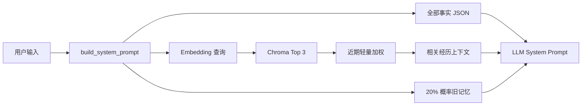

# Neuro 长期记忆架构与迭代指南

更新日期：2026-06-21（第 5 步「持久数据目录迁移」已完成）

## 1. 目标

桌宠的长期记忆不是“存下所有对话”，而是长期保持以下能力：

- 记得稳定事实、偏好、重要人物和承诺。
- 能在相关话题中自然召回，不生硬罗列。
- 新信息与旧信息冲突时能更新或询问。
- 用户可以查看、纠正、忘记、导出和删除。
- 应用升级、重启或换工作目录后记忆仍存在。
- 不把隐私内容泄露到日志、其他账号或无关 Prompt。

## 2. 当前实现审计

### 2.1 数据层

`backend/memory.py` 的 `MemorySystem(user_id)` 当前包含两类记忆：

```text
事实记忆
  backend/user_facts/<user_id>.json
  例：喜欢的颜色、习惯、重要人物

情景记忆
  backend/memory_db/
  Chroma collection: episodes_<user_id>
  例：某天说过正在学吉他
```

账号、上次出现时间和人格选择另存在 `backend/users.db`。

### 2.2 读路径



当前还保留最后 10 条短期对话历史。

### 2.3 写路径

模型按 JSON 返回：

```json
{
  "memory_operation": {
    "new_facts": {"key": "value"},
    "new_episode": "本次值得记住的事件摘要",
    "is_silence_requested": false
  }
}
```

`execute_updates()` 会：

- 忽略非字典操作。
- 过滤空事实。
- 事实文件通过 `.tmp + os.replace` 原子保存。
- 情景记忆生成 embedding 后写入 Chroma，并附带日期、时间、星期和情绪。

### 2.4 已有优点

- 每用户独立事实文件和 Chroma collection。
- 事实写入失败不会覆盖旧文件。
- 记忆内容不直接打印到日志。
- 路径相对模块目录，不依赖启动工作目录。
- 相关记忆和旧记忆都有基础召回。
- 已有完整性、隐私和路径测试。

## 3. 当前主要缺口

按风险排序：

### P0：数据目录不是真正的应用数据目录

`users.db`、`user_facts/` 和 `memory_db/` 都在源码目录。开发时可用，但打包、覆盖安装、自动更新或只读安装目录会造成持久化风险。

### P0：召回没有相关性门槛

只要 Chroma 有数据，就会返回 Top 3；即使都与当前问题无关，也可能被塞入 Prompt。

### P0：模型写入缺少语义校验

当前只校验类型和空值，没有：长度限制、事实键规范、去重、冲突策略、重要度或可信度。

### P1：事实无边界增长

全部事实每轮都进入 Prompt。使用时间越长，token 成本越高，旧事实和新事实也更容易冲突。

### P1：经历只有文本和时间

缺少主题、重要度、参与人、来源、访问次数、最后召回时间、版本和状态。

### P1：没有用户控制

用户不能查看“你记住了什么”，也不能纠正、忘记、导出或清空自己的数据。

### P2：没有合并和归档

相似对话会不断新增，长期后产生重复片段，降低检索质量。

### P2：Embedding 版本未记录

更换 embedding 模型后，旧向量和新向量可能不可比较，也没有重建索引流程。

## 4. 推荐目标架构

不要一次重写。保留现有事实 JSON + Chroma，逐阶段演进。

### 4.1 持久数据目录

增加一个统一配置：

```text
NEURO_DATA_DIR
```

Windows 默认建议：

```text
%LOCALAPPDATA%\Neuro\
  users.db
  user_facts\
  memory_db\
  backups\
```

迁移规则：

1. 新目录不存在时检查旧源码目录。
2. 先复制到临时目录并校验，再原子切换。
3. 迁移成功后保留旧数据一段时间，不立即删除。
4. 迁移记录只写数量和状态，不写记忆正文。
5. 自动化测试必须覆盖旧路径迁移和重复启动幂等。

### 4.1.1 已实现（2026-06-21）

`backend/config.py` 的 `Config.DATA_DIR` 解析：优先 `NEURO_DATA_DIR` 环境变量，
否则按平台落到 `%LOCALAPPDATA%\Neuro`（Windows）、`~/Library/Application Support/Neuro`（macOS）、
`~/.local/share/Neuro`（Linux）。`backend/migrate.py` 在 `main.py` 启动时、`db.init_db()`
之前执行一次性原子迁移（tmp+rename），幂等（新目录有 `.migrated` 标记则跳过），不覆盖新目录已有数据，
旧数据保留不删，日志只记条目数量不记正文。

已迁移到 `Config.DATA_DIR` 的条目：`users.db`、`user_facts/`、`memory_db/`、`.jwt_secret`、`persona_state.json`。
`memory.py` / `db.py` / `auth.py` 均改用 `Config.DATA_DIR`，模块常量名（`DB_PATH` / `LEGACY_PERSONA_PATH`）
和 `_load_secret(path=...)` 签名保留，测试仍可 patch。

测试覆盖：`test_data_migration.py`（迁移填充、幂等、不覆盖、日志不泄露正文）、`test_memory_storage.py`
（向量库路径走 `Config.DATA_DIR`）。

### 4.2 记忆记录结构

第一阶段仍可把内容存 Chroma document，把以下字段放 metadata：

```json
{
  "user_id": "uuid",
  "type": "episode",
  "date": "2026-06-21",
  "emotion": "happy",
  "salience": 0.75,
  "topic": "work",
  "source": "chat",
  "content_hash": "sha256...",
  "embedding_model": "model-id",
  "status": "active",
  "created_at": 1782020000,
  "last_accessed_at": 1782020000,
  "access_count": 0
}
```

不要立刻新增复杂 ORM。只有编辑、审计、合并和删除开始让 Chroma metadata 难以维护时，再把结构化元数据移到现有 SQLite，并让 Chroma 只保存向量索引和 record id。

### 4.3 事实结构

当前事实值直接覆盖。下一步最小结构：

```json
{
  "favorite_drink": {
    "value": "无糖咖啡",
    "confidence": 0.9,
    "source": "explicit_user_statement",
    "updated_at": 1782020000
  }
}
```

明确陈述的事实可信度高；模型推断不能直接成为高可信事实。矛盾时保留旧值到历史记录，回复中询问确认，再更新当前值。

## 5. 召回算法

### 5.1 先过滤，再排序

推荐流程：

```text
查询 8 条候选
  -> 过滤无关距离
  -> content_hash 去重
  -> 过滤 status != active
  -> 语义/时间/重要度综合排序
  -> 在 token 预算内最多选 3-5 条
```

分数可从简单公式开始：

```text
score = semantic * 0.70
      + salience * 0.15
      + recency * 0.10
      + access_bonus * 0.05
```

Chroma 距离含义取决于 collection metric，不能拍脑袋写固定阈值。先用一组“相关/无关”测试样本测分布，再把阈值放到配置中。

### 5.2 Prompt 预算

长期记忆上下文应有独立预算，例如 600-1000 tokens：

- 稳定事实只选当前话题相关项。
- 重要承诺和人物关系优先。
- 情景记忆按综合分选取。
- 超预算时截断整条低优先级记忆，不截断句子中间。

### 5.3 防止过度回忆

不是每次回复都必须提旧事。召回结果只是可用上下文：

- 高相关且自然时引用。
- 用户问“你记得吗”时明确回答。
- 无关时不提。
- 同一条记忆在短时间内不要反复引用。

## 6. 写入质量

### 6.1 确定性校验

模型输出进入存储前检查：

- `new_facts` 必须是字典。
- key 只允许小写字母、数字和下划线，长度受限。
- value 必须是短字符串、数字、布尔值或受限数组。
- 单条 episode 限制长度。
- 拒绝空泛摘要，如“主人和我聊了天”。
- 计算规范化文本 hash，避免重复写入。
- 不把模型的 thought、系统 Prompt 或 API 错误存为记忆。

### 6.2 重要度

先用规则，不必再调用一个 LLM：

- 明确偏好、承诺、重要人物：0.8-1.0。
- 正在进行的项目或近期计划：0.6-0.8。
- 普通有意义事件：0.4-0.6。
- 闲聊、寒暄、重复信息：不写。

### 6.3 冲突

同一事实 key 新旧值不同时：

1. 用户明确说“我现在改成……”：更新并记录旧值。
2. 模型推断与旧事实冲突：不更新。
3. 表述含糊：对话中询问确认。

## 7. 记忆合并

不要每轮执行。满足任一条件时后台合并：

- 单用户 active episode 超过 200 条。
- 某主题相似片段超过 10 条。
- 一次会话结束且有 20 条以上消息。

合并产物应是新的摘要记录，原记录标记 archived，不立即删除。合并失败不影响原始记忆。

示例：

```text
原始：多次提到正在学习 Godot、做竖屏 ARPG、关注战斗美术。
摘要：主人长期在做 Godot 竖屏 ARPG，尤其在意动作因果、伤害数字和 UI 质感。
```

## 8. 用户控制和隐私

至少提供：

- 查看事实列表。
- 搜索经历。
- 修正单条事实。
- 忘记单条记录。
- 导出当前用户 JSON。
- 删除当前用户全部记忆。

删除流程必须同时处理事实、向量记录、备份策略和缓存。任何导出和删除都必须基于已验证的 `user_id`，不能接受客户端传入任意文件名或 collection 名。

不要记录：API Key、密码、访问令牌、完整屏幕截图、系统 Prompt、模型 thought、未经同意的敏感健康/财务信息。

## 9. 与人格和主动行为的关系

人格选择与记忆共享是当前正确方向：人格改变说话方式，不复制一份新记忆。

主动发言可使用记忆，但必须有冷却：

- 最多带一条相关旧事。
- 不在勿扰、说话、思考或用户高频输入时触发。
- 同一主题至少间隔数小时。
- 重要提醒需要用户显式同意，不从普通聊天自动变成闹钟。

## 10. 测试清单

当前已有：

- 事实原子写入失败保持旧数据。
- 畸形模型指令被忽略。
- 旧记忆随机窗口不是固定第一批。
- 私密正文不写日志。
- 向量路径不依赖 cwd。
- 账号与人格持久化。

下一阶段增加：

- 两个用户无法互相召回。
- 无关查询不返回记忆。
- 重复 episode 只保留一条 active 记录。
- 事实冲突不会静默覆盖高可信值。
- token 预算不会超限。
- embedding 失败时聊天仍可用。
- 导出只包含当前用户。
- 删除后事实和向量都不可召回。
- 旧数据目录迁移幂等。
- embedding 模型变更可重建索引。

运行基线：

```powershell
Set-Location D:\work\desktop-pet\backend
python -m unittest discover -v
```

## 11. 推荐实施顺序

1. ✅ 统一 `NEURO_DATA_DIR` 和旧数据迁移。（已完成，见 4.1.1）
2. 为 episode 增加 hash、salience、topic、embedding_model。
3. 增加召回阈值和 token 预算。
4. 增加去重和事实冲突策略。
5. 增加查看/纠正/忘记/导出/删除接口。
6. 数据量达到阈值后再做会话总结和合并。
7. 需要复杂审计时再引入 SQLite memory metadata 表。

每一步都先增加一个会失败的契约测试，再做最小实现。

