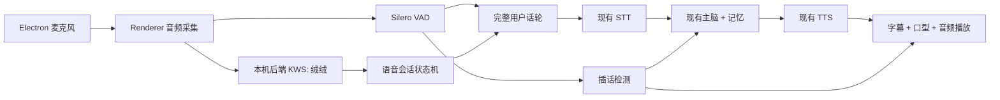

# “绒绒”唤醒与连续语音设计

日期：2026-06-23  
状态：设计已口头确认，待书面复核

## 目标

把当前“按键录完再发送”的语音输入升级为贾维斯式交互：

- 用户说“绒绒”即可唤醒，不需要点击或按 F2。
- 唤醒后进入 60 秒连续会话，后续每句话无需重复唤醒。
- 自动判断用户说完，并沿用现有人格、记忆、主脑和语音合成。
- 绒绒说话时允许用户插话，旧播放立即停止，旧回复不再继续发送。
- 待机音频只用于本机唤醒检测，不上传外网、不落盘、不写日志。
- 朋友安装 Windows 包后可直接使用现有付费 Key，不要求安装额外运行时。

第一版追求低延迟的连续轮流对话，不承诺电影级同时收听和说话的真全双工。

## 非目标

- 不更换现有 LLM、STT、TTS 服务或增加另一套付费 Key。
- 不做声纹识别、多人分离、远场麦克风阵列或环境降噪训练。
- 不保存原始麦克风音频。
- 不重写人格、记忆和现有聊天协议。
- 不删除文字输入和 F2 按住说话兜底。

## 当前基线

当前链路为：

1. `VoiceInput.jsx` 用 `MediaRecorder` 录制整段 WebM。
2. 用户手动停止后，整段音频通过 `audio_input` 发送。
3. 后端 `speech_to_text()` 完成整段识别。
4. `handle_user_input()` 调用现有主脑和记忆。
5. `text_to_speech()` 合成完整 MP3，前端收到后一次播放。

仓库已经安装 `@ricky0123/vad-react` 和 `@ricky0123/vad-web`，但当前录音组件未使用它们。现有 `interrupt` 只修改状态，不能可靠取消正在进行的主脑或 TTS 结果。

## 方案选择

### 采用：本地唤醒 + 现有云端对话链路

- 本地唤醒使用 sherpa-onnx 中文 KWS 模型。
- 自动断句复用已安装的 Silero VAD。
- 唤醒后的每段用户语音继续走现有 STT、主脑、记忆和 TTS。
- 用会话代次号屏蔽被打断后的迟到结果。

这条路径新增成本最小，保留现有 Key 和业务能力，同时避免待机音频持续上传。

### 未采用：云端实时语音模型

延迟可能更低，但需要新的服务兼容性、计费和 Key，并会绕开或重做现有人格与记忆链路。

### 未采用：唤醒后启动旧录音按钮

改动最少，但仍要手动结束录音，不能形成连续会话，也不能可靠插话。

## 架构

### 音频所有权

- Renderer 继续负责麦克风权限和单一音频流，保持 Electron `sandbox` 与 `contextIsolation` 边界。
- 音频转为 16 kHz、单声道、Int16 PCM，每 100 ms 通过现有认证 WebSocket 发往本机后端。
- 待机 PCM 只喂给本机 KWS，不调用外部 API。
- 唤醒后的 VAD 完整话轮才编码并进入现有 STT。
- WebSocket 服务仍只绑定 `127.0.0.1`。

### 本地唤醒

- 使用 sherpa-onnx `KeywordSpotter` 和中文 WenetSpeech 3.3M mobile 模型。
- 模型随安装包分发，压缩资源约 15 MB。
- 关键词文件只包含“绒绒”，使用模型要求的中文拼音 token 格式。
- 唤醒阈值和关键词分数保留环境配置项，默认值经过本机录音校准后固化。
- 触发后立即返回 `wake_detected`，前端播放短提示音并进入 `listening`。

官方依据：

- [sherpa-onnx 实时麦克风关键词示例](https://github.com/k2-fsa/sherpa-onnx/blob/master/python-api-examples/keyword-spotter-from-microphone.py)
- [中文 KWS 模型发布资源](https://github.com/k2-fsa/sherpa-onnx/releases/tag/kws-models)

### 连续会话

状态机只有以下状态：

- `disabled`：用户关闭麦克风或权限不可用。
- `sleeping`：只进行本地唤醒检测。
- `listening`：已唤醒，等待或接收用户语音。
- `thinking`：STT 已完成，主脑处理中。
- `speaking`：播放绒绒回复。

规则：

- 首次说“绒绒”后进入 `listening`。
- 只说唤醒词时，绒绒提示已唤醒并等待下一句。
- 说“绒绒，帮我看看……”时，保留同一话轮并去掉开头唤醒词再发送给主脑。
- 每次用户话轮或助手回复都会刷新 60 秒会话计时。
- 连续 60 秒没有有效语音后回到 `sleeping`。
- 待机监听不暂停桌面漫游；有效用户发言、思考和说话沿用现有暂停原因。

### 插话与取消

- `speaking` 时麦克风和 VAD 仍工作，并启用浏览器回声消除。
- 检测到持续有效人声后，前端立即调用现有 `stopAudio()`。
- WebSocket 接收循环不再等待 `handle_user_input()` 完成；每个用户只保留一个活动话轮任务，因此思考和合成期间仍能接收 PCM 与 `interrupt`。
- 前端发送 `interrupt`，后端递增该用户的语音代次号并取消可取消任务。
- 旧 STT、主脑或 TTS 如果在打断后才返回，会因代次号不匹配而不得发送、写入历史或更新记忆。
- 新话轮随后按正常流程处理。

## 协议

新增最小消息集合：

- 客户端 `voice_pcm`：`audio_base64`、`sample_rate`，只允许 16 kHz Int16 单声道和受限大小。
- 服务端 `wake_detected`：唤醒词和当前会话代次号。
- 服务端 `voice_state`：`sleeping/listening/thinking/speaking/disabled`。

保留现有 `audio_input`、`text_input`、`interrupt` 和 `audio_chunk`。协议解析层负责类型、采样率和单包大小校验，模型输出不能直接生成语音控制命令。

## 用户界面

- 麦克风按钮改为唤醒总开关，并显示关闭、待机、聆听三种明确状态。
- 托盘增加“语音唤醒”勾选项，状态持久化。
- 首次启用时使用系统麦克风权限提示；拒绝后保持 `disabled`。
- 唤醒时只显示短状态反馈和提示音，不增加教学弹窗或大段说明。
- 文字输入和 F2 保留，网络或模型故障时可以继续使用。

## 隐私与安全

- 原始 PCM 和录音 Blob 不写文件、不写日志、不进入测试快照。
- `sleeping` 状态不调用 STT、LLM 或 TTS。
- 只有登录成功、WebSocket 已认证且语音唤醒已启用时接收 PCM。
- 后端限制 PCM 包大小、采样率和发送频率，异常输入直接拒绝。
- 不扩大 preload API；托盘开关只新增命名明确的白名单 IPC。
- 麦克风关闭、退出登录、窗口退出或连接断开时必须停止所有音轨和计时器。

## 故障降级

- KWS 模型加载失败：关闭唤醒，保留 F2 和文字输入。
- 麦克风权限被拒绝：显示关闭状态，不循环请求权限。
- STT 返回空文本：回到 `listening`，不调用主脑。
- 网络失败：保留当前会话窗口并提示一次，避免循环播报错误。
- 误唤醒：无有效后续语音时在短超时后恢复 `sleeping`。

## 验证

自动测试：

- 语音状态机的唤醒、续期、超时和关闭。
- `voice_pcm` 的认证、格式、大小和采样率校验。
- 插话后才返回的旧代次回复、历史和记忆更新全部被丢弃。
- KWS 适配器使用固定 PCM 样本验证“绒绒”命中和普通语音不命中。
- Electron IPC 仍保持白名单、sandbox 和 contextIsolation 契约。
- 现有 F2、文字输入、音频播放和漫游暂停测试继续通过。

Windows 打包实测：

- 安装后无需 Python、Node 或额外模型下载。
- 普通音量说“绒绒”可在可接受距离内唤醒。
- “绒绒，今天……”能作为同一话轮处理。
- 60 秒内连续追问无需重复唤醒。
- 绒绒说话时插话，旧声音立即停止，打断后才返回的旧结果不污染记忆。
- 禁用语音唤醒后麦克风轨道停止，待机音频没有外网请求。
- 麦克风拒绝、断网、重连和应用退出均能正常降级或清理。

## 完成标准

- 唤醒确认的本地反馈不依赖外网。
- 用户无需按键完成至少三轮连续语音对话。
- 插话后 300 ms 内停止本地播放。
- 待机音频不产生 STT、LLM、TTS 请求。
- 新安装包在 Windows x64 上完成真实麦克风和打断验证。
